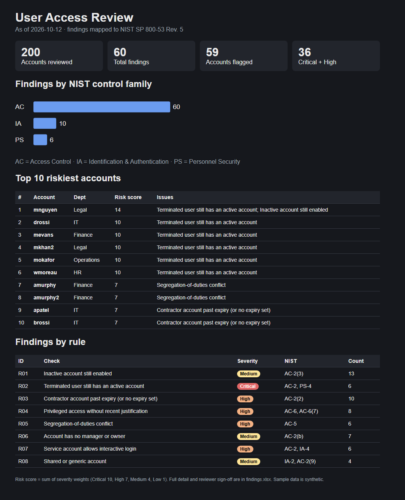
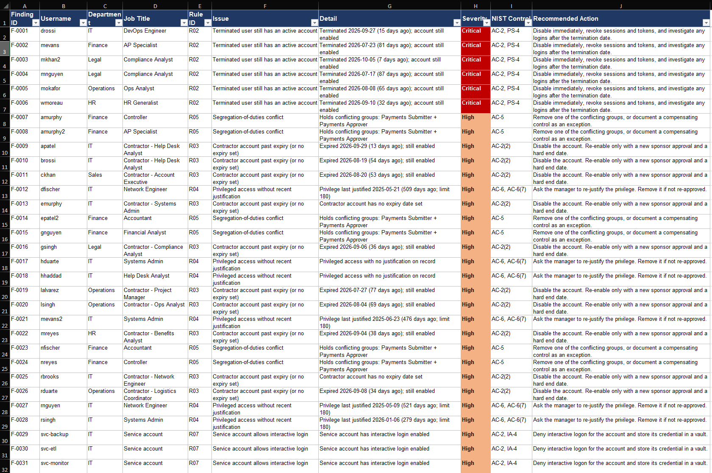
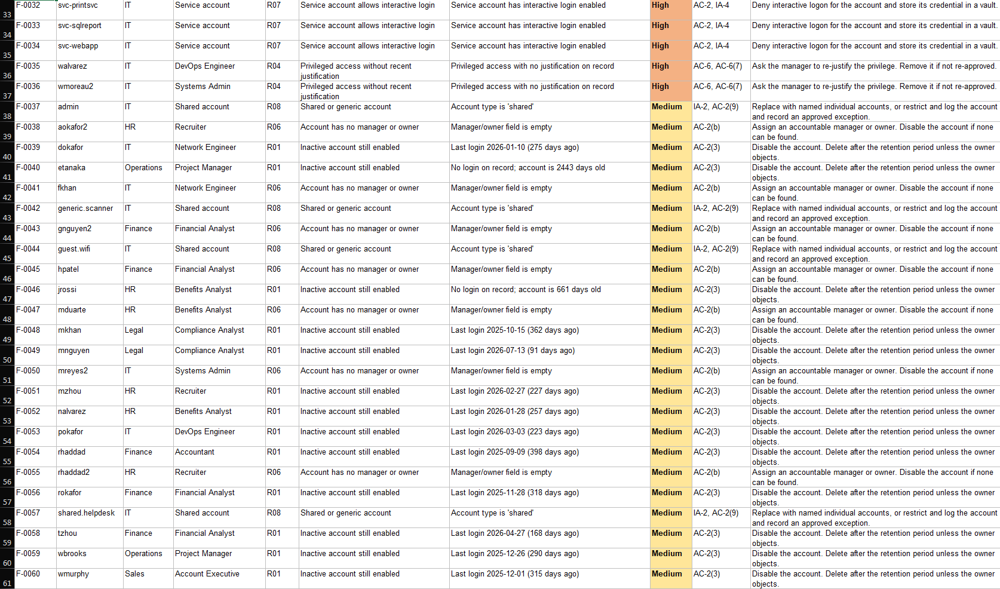
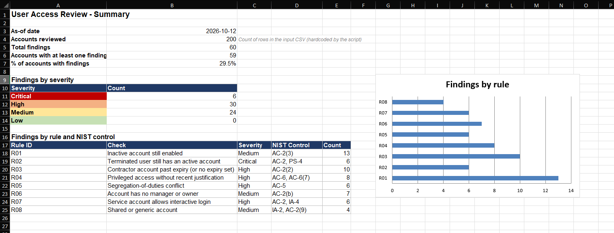

# NIST 800-53 User Access Review Automation

Built by Daniel Guy with assistance from Claude (Anthropic). All sample data is synthetic.

A Python tool that takes a user-access export, flags risky accounts, maps every finding to a
NIST SP 800-53 Rev. 5 control, and produces reviewer-ready evidence. It automates the part of a
quarterly user access review (UAR) that is usually done by hand in spreadsheets.

**Sample result:** 200 accounts reviewed, 60 findings across 59 accounts, all 59 planted issues caught.

## Quick start
```bash
pip install -r requirements.txt
python make_sample_data.py          # creates data/sample_users.csv (synthetic) + data/answer_key.csv
python access_review.py             # writes output/findings.xlsx and output/report.html
python verify_against_key.py        # proves the tool catches every planted issue
```
Use `--input your_export.csv`, `--rules other_rules.yaml`, or `--as-of 2026-09-30` to change inputs.

## Input columns
`username, display_name, department, job_title, manager, account_status, last_login, created_date,
groups (semicolon-separated), privileged (yes/no), privileged_justified_date, account_type
(employee/contractor/service/shared), termination_date, expiry_date, interactive_login (yes/no)`

Dates are ISO (`YYYY-MM-DD`); blanks are allowed. All sample data is fake.

## Checks and NIST mapping
| ID | Check | Severity | NIST 800-53 |
|---|---|---|---|
| R01 | Enabled account inactive 90+ days | Medium | AC-2(3) |
| R02 | Terminated user still enabled | Critical | AC-2, PS-4 |
| R03 | Contractor past expiry or with no expiry | High | AC-2(2) |
| R04 | Privileged access, no justification in 180 days | High | AC-6, AC-6(7) |
| R05 | Conflicting groups (segregation of duties) | High | AC-5 |
| R06 | No manager or owner | Medium | AC-2(b) |
| R07 | Service account with interactive login | High | AC-2, IA-4 |
| R08 | Shared or generic account | Medium | IA-2, AC-2(9) |

Rules, thresholds, SoD group pairs, and recommendations live in `rules.yaml`. Changing a threshold
needs no code change. A new rule type = one new function in `access_review.py` + one `CHECKS` entry.

## Outputs
Downloadable at: [report.html](output/report.html)


## Findings & Summary
Downloadable at: [findings.xlsx](output/findings.xlsx)





## Design notes
- Rules are data, not code, so a reviewer can tune them without touching Python.
- Risk score per account = sum of severity weights, used to rank the top 10.
- One account can trigger several rules; a terminated user who is also idle shows up under R01 and R02.
- Limits: only as good as the export. Group names, SoD pairs and thresholds must be tailored to the organization.


